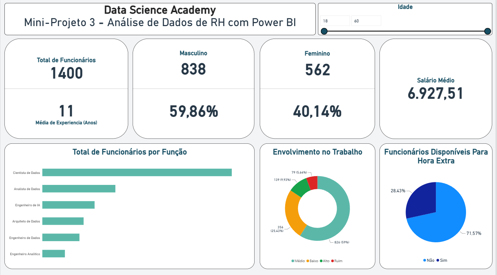

# 👥 Análise de Dados de RH com Power BI

## 🎯 Sobre o projeto

Mini-projeto desenvolvido durante minha formação na **Data Science Academy (DSA)**, no curso **Microsoft Power BI para Business Intelligence e Data Science**, com o objetivo de analisar dados de Recursos Humanos por meio de indicadores e visualizações interativas.

O dashboard permite explorar informações sobre o quadro de funcionários, experiência profissional, remuneração, distribuição por função, disponibilidade para horas extras e nível de envolvimento no trabalho.

## 🛠️ Ferramenta utilizada

- Power BI Desktop

## 📈 Indicadores e análises

O dashboard foi desenvolvido para responder a perguntas de negócio relacionadas à gestão de Recursos Humanos.

### 👥 Quadro de funcionários

- Total de funcionários;
- Distribuição de funcionários por gênero;
- Percentual de funcionários masculinos e femininos;
- Filtro de idade para explorar diferentes faixas etárias.

### 💼 Experiência e remuneração

- Média de experiência profissional em anos;
- Média salarial dos funcionários;
- Distribuição de funcionários por função.

### ⏱️ Disponibilidade para horas extras

- Percentual de funcionários disponíveis para realizar horas extras;
- Comparação entre funcionários disponíveis e não disponíveis.

### 📊 Envolvimento no trabalho

Análise da distribuição dos funcionários de acordo com quatro níveis de envolvimento:

- Ruim;
- Baixo;
- Médio;
- Alto.

## 📊 Visualizações utilizadas

Foram utilizadas diferentes visualizações do Power BI para facilitar a interpretação dos dados:

- **Indicadores (Cards):** apresentação do total de funcionários, média de experiência e salário médio;
- **Gráfico de barras horizontais:** comparação da quantidade de funcionários por função;
- **Gráfico de rosca:** distribuição dos funcionários por nível de envolvimento no trabalho;
- **Gráfico de pizza:** visualização da disponibilidade para realizar horas extras;
- **Segmentação por idade:** filtro interativo para explorar os dados por faixa etária.

## 🎛️ Interatividade

O relatório possui um filtro de idade que permite selecionar intervalos entre 18 e 60 anos, possibilitando explorar os indicadores de acordo com a faixa etária selecionada.

## 🔎 Principais informações

Com base nos resultados apresentados no dashboard, destacam-se:

- **1.400 funcionários** analisados;
- **11 anos** de média de experiência profissional;
- **6.927,51** de salário médio, na unidade monetária utilizada pelo conjunto de dados;
- **838 funcionários masculinos**, correspondendo a 59,86% do total;
- **562 funcionárias femininas**, correspondendo a 40,14% do total;
- **71,57%** dos funcionários não estão disponíveis para realizar horas extras, enquanto 28,43% estão disponíveis;
- **59%** dos funcionários apresentam nível médio de envolvimento no trabalho;
- A função de Cientista de Dados apresenta a maior quantidade de funcionários entre as funções exibidas no dashboard.

Esses indicadores permitem conhecer melhor a composição do quadro de funcionários e explorar aspectos relacionados à experiência, remuneração e envolvimento profissional.

## 🖼️ Dashboard

## 🎓 Contexto

Projeto desenvolvido como parte do curso **Microsoft Power BI para Business Intelligence e Data Science**, da Data Science Academy (DSA).

## 👨‍💻 Autor

**Vinicius Marques**

Análise e Desenvolvimento de Sistemas | Power BI | Excel | SQL | Análise de Dados
